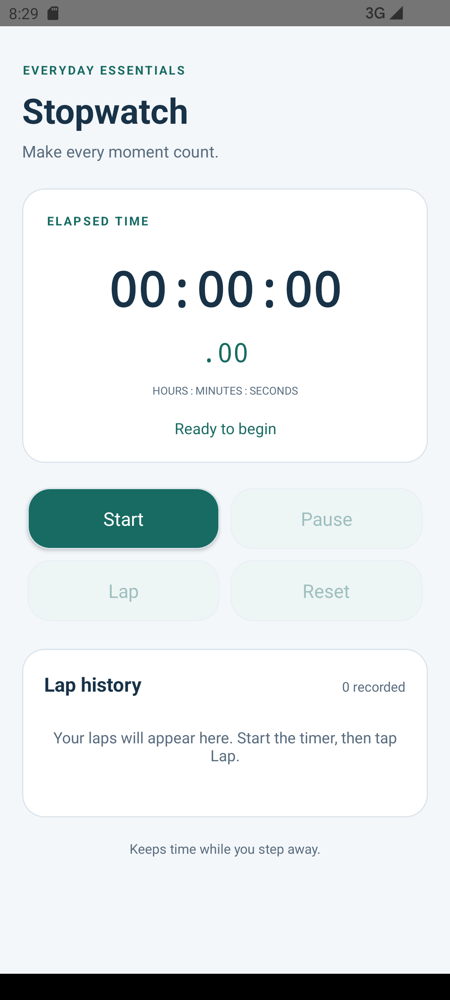
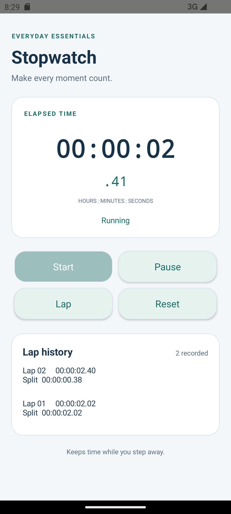
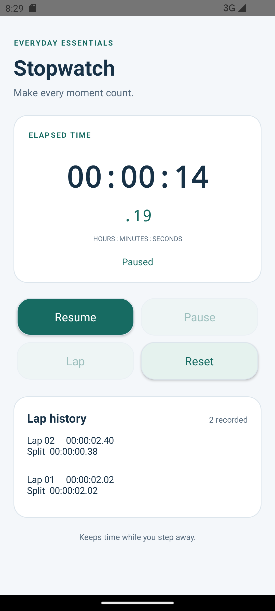

# Stopwatch - OIBSIP Task 5

Offline Java/XML Android stopwatch by Warisha Ijaz. Consistent teal/white design with the Unit Converter and Calculator. No network, foreground service or notification permission.

## Features
- Large HH:MM:SS display plus hundredths under the main time.
- Start from zero; Resume from paused elapsed duration.
- Pause freezes logical elapsed time; Reset stops and zeros the timer.
- Running/paused/ready status and enabled/disabled button feedback.
- Running time includes time spent away from the screen, including device sleep.
- Saved instance state preserves running/paused state and laps over Activity recreation.
- Bonus: newest-first lap history with cumulative elapsed times and per-lap splits; list scrolls with the page. Reset clears laps. Maximum 200 laps per session to bound saved state and UI memory.

## Timing architecture
SystemClock.elapsedRealtime() supplies a monotonic timestamp. While running:

`elapsed = accumulatedPausedDuration + (now - startedAt)`

On Pause, current elapsed is stored in accumulated duration. Resume records a fresh start timestamp. UI updates never add time; they only redraw the current elapsed value. A main-thread Handler updates every 50 ms while visible and running. Each schedule removes any previous callback; onPause/onDestroy remove callbacks. The engine remains logically running while the Activity is hidden. onResume draws the latest elapsed time and schedules updates again.

## Persistence limits
No persistent preferences/database or background service. Background/return and configuration changes are supported. OS-supplied saved instance state can restore the session after process recreation on the same boot; force-stop, clearing the task/data or a fresh session can reset it. Boot count is saved and compared so a restored session from a different boot is reset. Reboot/process-death restoration has not been claimed as tested. This is a local stopwatch, not a certified precision timing instrument; UI refresh is approximately 50 ms and the displayed hundredths do not imply 10 ms measurement accuracy.

## Build/run
Open this folder in Android Studio; configure local SDK path. SDK platform 36, Gradle 9.3.0, AGP 9.0.1; JDK 17+ required, tested with bundled JDK 21.0.10. Minimum Android 8 / API 26.

Windows: `gradlew.bat assembleDebug`. macOS/Linux: `sh gradlew assembleDebug`. Choose emulator/phone and Run. APK is app/build/outputs/apk/debug/app-debug.apk. Do not commit local.properties or build output.

## Structure
- StopwatchEngine.java: clock-independent state, elapsed calculations, laps and formatting.
- MainActivity.java: elapsedRealtime clock input, Handler callbacks, screen lifecycle, buttons and lap rows.
- res/layout/activity_main.xml: scrollable XML layout.
- res/values and res/drawable: theme, labels, colors and button/card backgrounds.
- tests/StopwatchEngineCheck.java: controlled-clock engine and formatting checks.
- app/src/androidTest: real Activity tests, background/return and recreation checks.

## Verification and screenshots
See VERIFICATION.md for actual build and test results; MANUAL_TESTS.md lists human checks still needed. Screenshots below are actual emulator captures.

| Ready | Running with laps | Paused after background return |
| --- | --- | --- |
|  |  |  |

 Documentation and a demo script are included; publishing and submission have not occurred.
